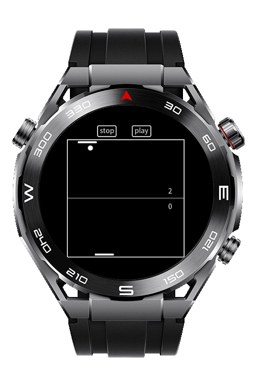
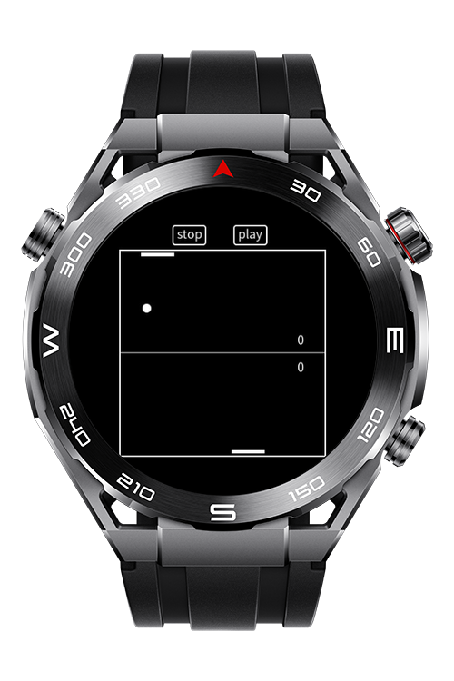
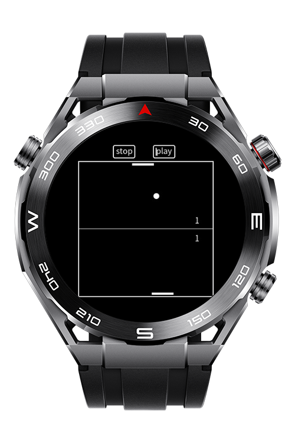

> **Note:** To access all shared projects, get information about environment setup, and view other guides, please visit [Explore-In-HMOS-Wearable Index](https://github.com/Explore-In-HMOS-Wearable/hmos-index).

# Pong Game

**Pong Game** is a 2D table-tennis-style game with simple black and white graphics.
The screen is split horizontally, with a ball bouncing between two paddles.
Bottom paddle is controlled by the **player**, the top paddle by the **computer** (AI opponent).

# Preview

<div>
  
  
  
  
</div>

# Use Cases

Simple yet entertaining little classic pong game for wearables.

# Technology
## Stack
- **Languages**: ArkTS / HML
- **Frameworks**: HarmonyOS 5.1.0 Beta1
- **Tools**: DevEco Studio 5.1.0.842
- **Libraries**:
    - `CanvasRenderingContext2D`

# Directory Structure

```
entry/
├── src/main/
│ 
├── src/main/js/MainAbility
│ ├── pages/index
│ │ ├── index.css
│ │ ├── index.hml
│ │ └── index.js
│ ├── lib
│ │ ├── constants.js
│ │ ├── game_controller.js
│ │ └── game_renderer.js
```

# Constraints and Restrictions
## Supported Device

- Huawei Sport (Lite) Watch GT 4/5/6
- Huawei Sport (Lite) GT4/5 Pro
- Huawei Sport (Lite) Fit 3/4
- Huawei Sport (Lite) D2
- Huawei Sport (Lite) Ultimate

# License

**Pong Game** is distributed under the terms of the MIT License

See the [LICENSE](./LICENSE) for more information.
